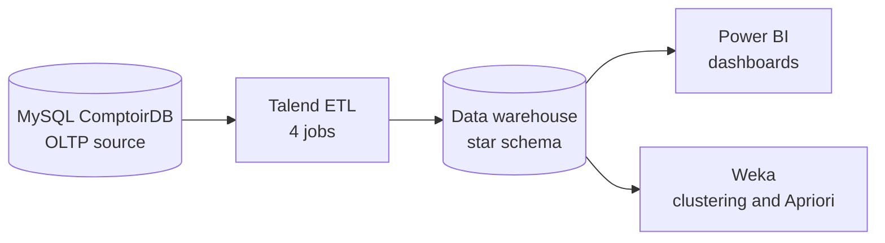
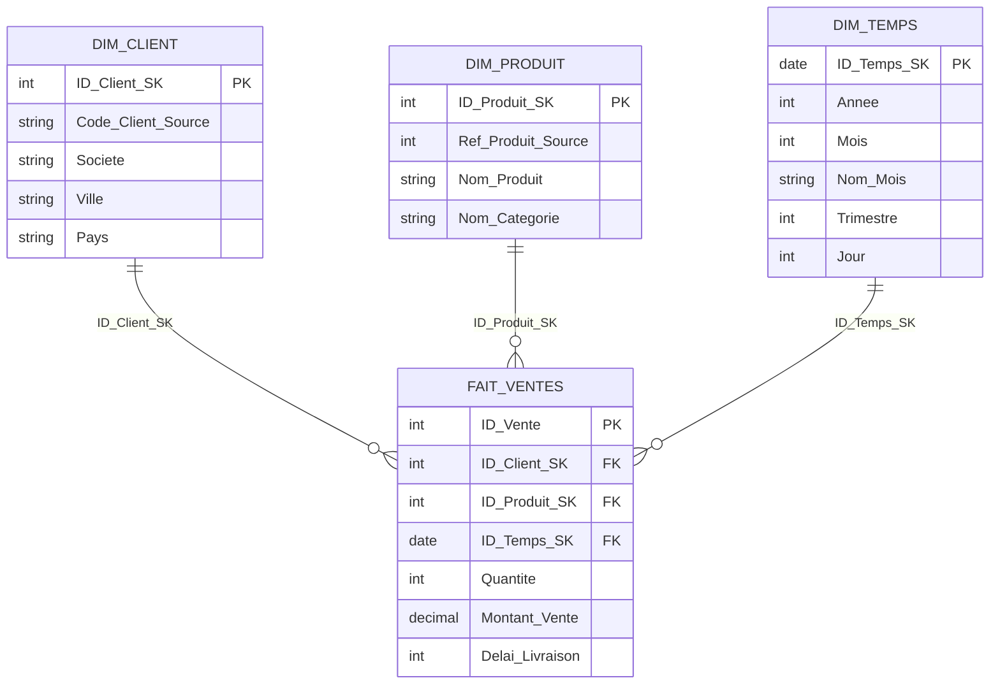

# BI & Data Mining Project – ComptoirDB

End-to-end decision-support project for the company **ComptoirDB**:
**ETL (Talend) → Star-schema data warehouse → Reporting (Power BI) → Data mining (Weka)**.

> Academic project completed in 2025 by **Monya OUBELLA**.
> No tool installation is required to browse this repository: results are provided as CSV/ARFF files and screenshots.

## Architecture



## Data model (star schema)



`Nom_Categorie` is denormalized into `dim_produit` to avoid extra joins (star-schema principle).

## ETL (Talend)

| Job | Role |
|---|---|
| `jDim_Client` | Reads `comptoir_clients`, selects/renames columns with `tMap` |
| `jDim_Produit` | Left join `produits` + `comptoir_categories` to denormalize the category |
| `jDim_Temps` | Extracts order dates, removes duplicates (`tUniqRow`), derives year/month/quarter/day |
| `jFait_Ventes` | Lookups on dimensions to get surrogate keys, computes `Montant = Prix × Quantité` and `Délai = date d'envoi − date de commande` |

## Repository structure

```
├── data/    dim_client.csv, dim_produit.csv, dim_temps.csv, fait_ventes.csv
├── weka/    QUEST_6_A.arff (clustering), QUEST_6_B.arff (association rules)
└── docs/    project report (PDF) and screenshots
```

## Results

- **Revenue by category**: Desserts rank first, Boissons last.
- **Sales over time**: peak around day 8 of July 2023, then a sharp drop.
- **Geography**: sales concentrated in Western Europe, with a presence in Mexico.
- **Logistics**: client "Bon app'" has the longest average delivery time (12 days).
- **Clustering (Weka EM)**: 5 clusters of delivery time, from about 2.4 days (express) to 12 days (problematic delays).
- **Association rules (Apriori)**: products frequently bought together, useful for cross-selling.

## Limitations

The dataset is very small (13 sales facts, 10 transactions), so the data-mining results are illustrative, not statistically significant.
The Talend jobs and the source MySQL database are not included in this repository.

## Tech

Talend Open Studio · MySQL · Power BI · Weka · Star schema / R-OLAP